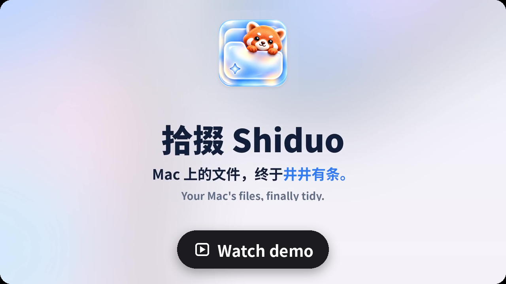
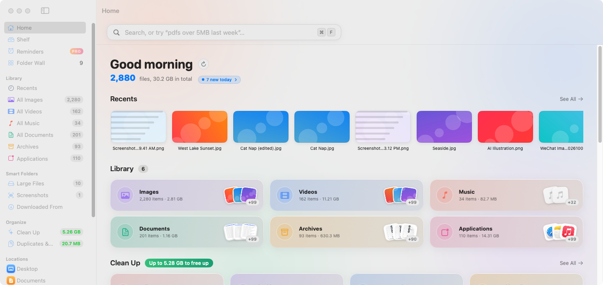
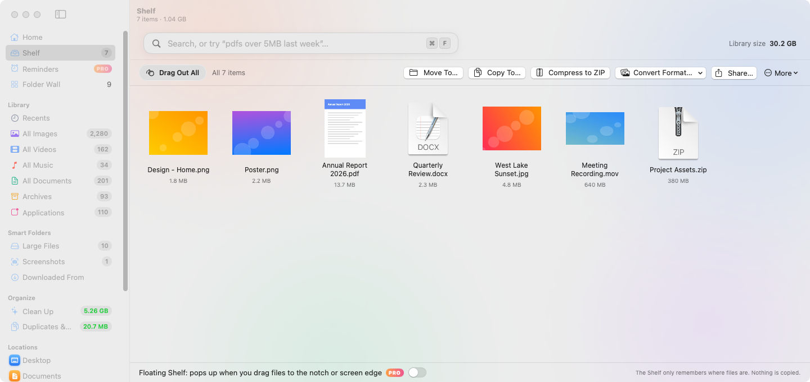
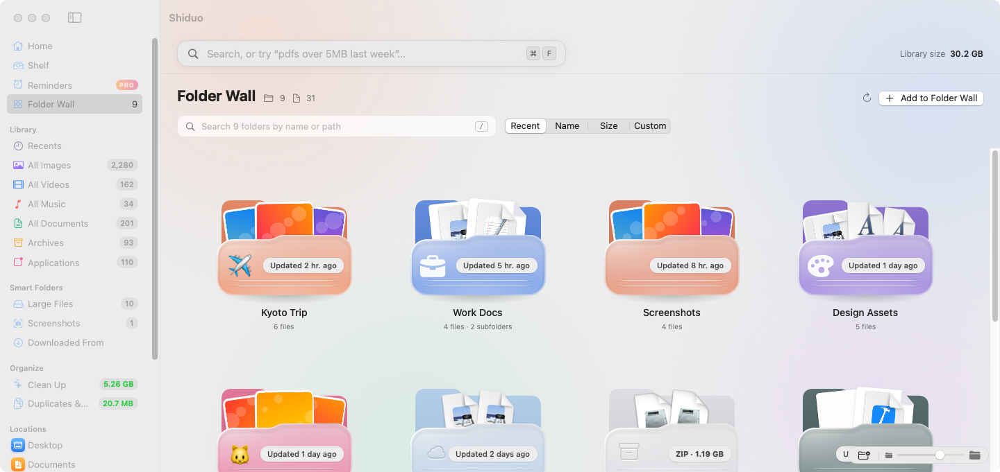
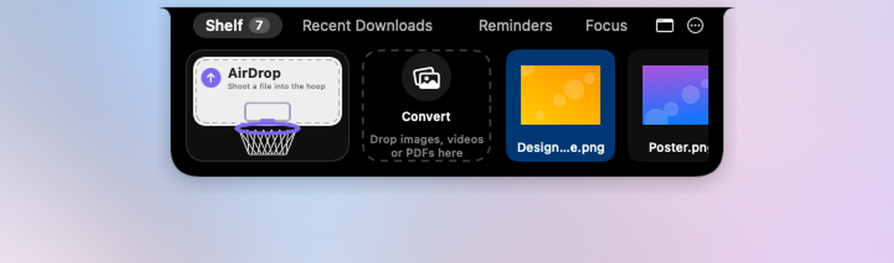
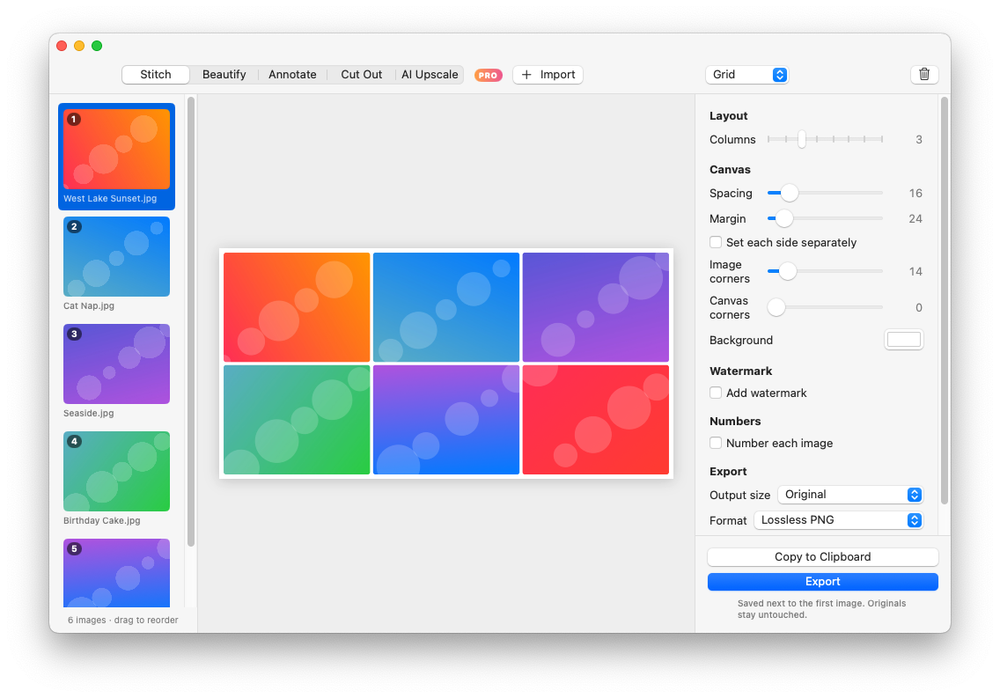
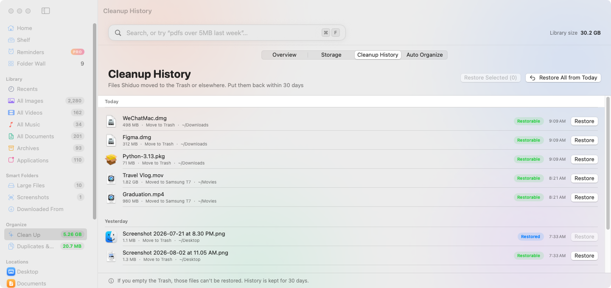
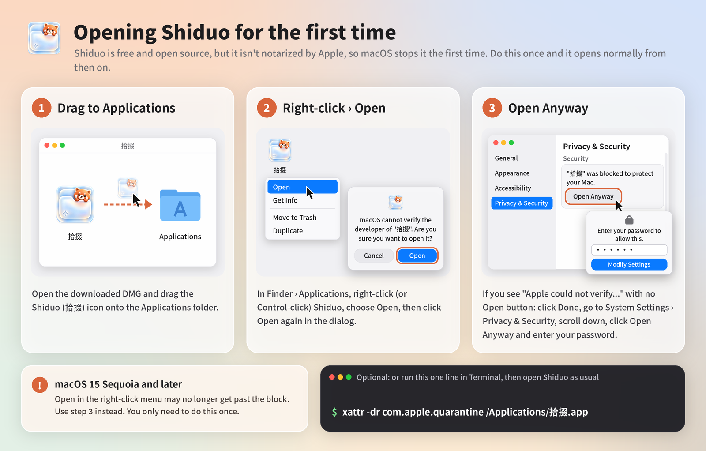

<p align="center"></p>

<h1 align="center">Shiduo 拾掇</h1>

<p align="center"><b>See your Mac’s files at a glance, find them with a sentence, and clean up safely.</b><br>A free, open-source companion to Finder. Everything happens on your Mac.</p>

<p align="center"><a href="README.md">简体中文</a> · English</p>

<p align="center">
  <a href="https://github.com/hanson-zz/Shiduo/releases/latest"></a>
  
  
  <a href="LICENSE"></a>
</p>

<p align="center"><a href="https://shiduo.app/#demo"></a></p>

<p align="center"></p>

Shiduo (拾掇, “to tidy up”) gathers the images, videos, documents and installers scattered around your Mac into one visual library. Search in plain English or Chinese, see where every download came from, and find duplicates and files you can safely remove. Nothing is uploaded.

The app is in English and Simplified Chinese. It follows your system language, and you can switch in **Settings › Language** (takes effect after a relaunch).

## Features

- **Visual library**: images, videos, music, documents, archives and apps, with big thumbnails, grid or list view, and Quick Look.
- **Plain-language search**: try `pdfs over 5MB last week`, `images from wechat`, `large videos from youtube.com this month`. The sentence becomes filters you can remove one by one.
- **Downloaded from**: recognizes Gmail, Google Drive, ChatGPT, WeChat, GitHub, Figma, browser extensions and 30+ other sources, and groups the rest by website.
- **Safe cleanup**: used installers, forgotten downloads, old screenshots, big old videos and rarely used apps. Files only go to the Trash, iCloud-only files are skipped, and folders macOS needs (your home folder, Desktop, Documents, Downloads, Library, Applications) can’t be moved, renamed or trashed.
- **Duplicates and similar photos**: exact copies by size and SHA-256, look-alike photos with Vision.
- **Shelf**: drop files from anywhere onto the Shelf in the sidebar to park them for a moment (only their locations are saved, nothing is copied), then drag them all out together, or move, copy, zip or AirDrop them in one go.

<p align="center"></p>

- **Folder Wall** (free): your go-to folders as cards, in two icon styles. **Shiduo style** (default) shows translucent Liquid Glass folders with real previews of the photos and documents inside; **System icons** shows the icons you see in Finder, including custom icons and colored folders.
- **Appearance**: follow the system, or always Light or Dark (**Settings › General**).
- **Handy tools**: text recognition in images (on-device), storage map, batch rename, convert to JPG, Finder tags, and a global quick-search panel (⌥Space).

## Shiduo Pro

Everything above is free forever. **Shiduo Pro** ($9.90 USD, one-time, payments by Creem) adds Organize Downloads with **Tidy Now** to actually move the files (previewing where each file would go and **Group Only** stay free), folder colors, auto-organize rules, weekly cleanup reminders, photo search by content, external drives in the sidebar, a menu bar helper, a floating shelf that opens under the notch or at the screen edge, file reminders (on time or when you open WeChat, DingTalk, Feishu or Mail), ⌃⌘1–0 number keys that copy your 10 most recent files, drop-to-convert tools (compress videos, make GIFs, trim clips, merge files into a PDF), an app uninstaller that also trashes the app’s leftovers in Library (restorable for 30 days), on-device background removal plus screenshot styling, image stitching (long screenshots joined with overlaps removed, grids, masonry, watermarks), screenshot annotation with on-device auto-blur, AI upscaling (2× / 4×, on your Mac), moving big files out to a drive or NAS with a stand-in left behind, and saved searches in the sidebar. The 7-day free trial starts only when you click **Start 7-Day Free Trial** (in **Settings › Pro** or on a Pro feature); no sign-up, no payment details. Enter your license key in **Settings › Pro**.

<p align="center"></p>

<p align="center"></p>

<p align="center"></p>

<p align="center"></p>

## Install

1. Download the latest [Shiduo.dmg](https://github.com/hanson-zz/Shiduo/releases/latest/download/Shiduo.dmg) (older versions are on [Releases](https://github.com/hanson-zz/Shiduo/releases)).
2. Open it and drag Shiduo to Applications.
3. The app isn’t notarized by Apple, so macOS stops it the first time. Follow **First launch** below once.

Requires macOS 14 Sonoma or later, on Apple silicon or Intel.

### First launch

<p align="center"></p>

1. Drag Shiduo from the DMG into **Applications**.
2. In Finder › Applications, **right-click** (or Control-click) Shiduo (拾掇), choose **Open**, then click **Open** again in the dialog.
3. If macOS says “Apple could not verify…” and there’s no Open button: click **Done**, go to **System Settings › Privacy & Security**, scroll down, click **Open Anyway** and enter your password.

Optional: or run this one line in Terminal, then open Shiduo as usual:

```bash
xattr -dr com.apple.quarantine /Applications/拾掇.app
```

> On macOS 15 Sequoia and later, **Open** in the right-click menu may no longer get past the block, so use step 3. You only need to do this once. The DMG also includes a “First launch guide.png”.

## Privacy

Shiduo only goes online to check for updates (GitHub) and to activate or verify a Pro license. Your files, file names and searches never leave your Mac. See the [Privacy Policy](https://shiduo.app/privacy.html), [Terms of Service](https://shiduo.app/terms.html) and [Refund Policy](https://shiduo.app/refund.html).

## Build it yourself

Needs Xcode 16 and [XcodeGen](https://github.com/yonaskolb/XcodeGen):

```bash
brew install xcodegen
xcodegen generate
open Shiduo.xcodeproj
```

UI strings live in `Resources/Localizable.xcstrings` (source language: Simplified Chinese, with English translations).

## Contact

Email 694561981@qq.com or open an [issue](https://github.com/hanson-zz/Shiduo/issues). Website: https://shiduo.app/

## License

[MIT](LICENSE)
