<p align="center"></p>

<h1 align="center">拾掇 Shiduo</h1>

<p align="center"><b>Mac 上的文件，一眼看清，一句话找到，放心清理。</b><br>开源、免费、全部在本机完成的“访达”好帮手。</p>

<p align="center">
  <a href="https://github.com/hanson-zz/Shiduo/releases/latest"></a>
  
  
  <a href="LICENSE"></a>
</p>

<p align="center">简体中文 · <a href="README.en.md">English</a></p>

<p align="center"><a href="https://shiduo.app/#demo">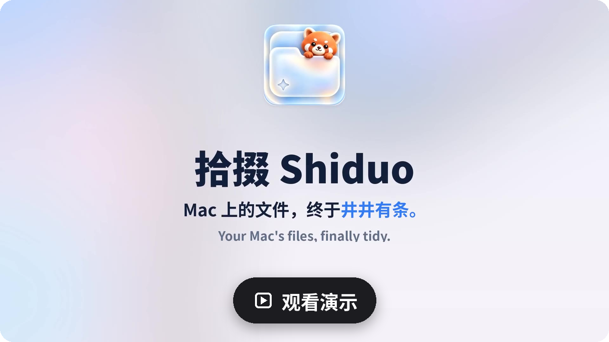</a></p>

<p align="center">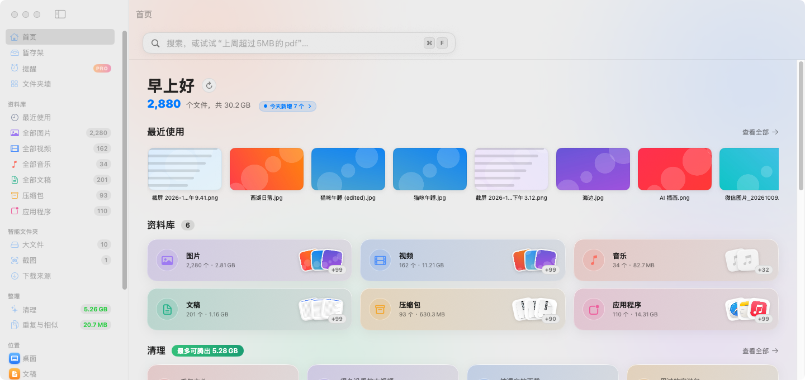</p>

拾掇是一款开源的 macOS 文件整理助手，和“访达”配合使用：把散落在各处的图片、视频、文稿、安装包按类型归拢，用一句话就能找到文件，还能帮你找出重复文件和可以放心清理的东西。所有处理都在本机完成，不上传任何文件。

> 截图使用的是内置演示数据（`--demo`），由 GitHub Actions 在 macOS 上自动截取。

## 一眼看清整台 Mac

首页把图片、视频、音乐、文稿、压缩包、应用各占多少空间排成彩色卡片，下面紧跟着“能腾出多少空间”的清理卡片和下载来源。窗口是磨砂玻璃质感，默认跟随系统浅色 / 深色模式，也可以在「设置 › 通用 › 外观」里固定成浅色或深色。

<p align="center">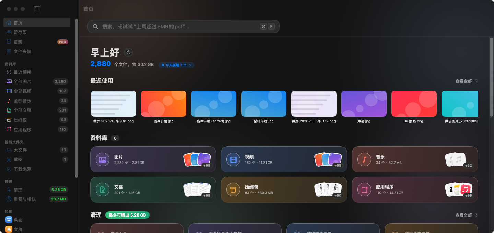</p>

- **资料库侧边栏**：最近使用、图片、视频、音乐、文稿、压缩包、应用程序，基于 Spotlight 索引，打开就有，旁边直接显示数量。
- **智能文件夹**：大文件、截图、下载来源；常用的文件夹放上「文件夹墙」。
- **暂存架**：把散在各处的文件先拖到侧边栏的「暂存架」放一下（只记住位置，不复制文件），攒齐了再一起拖进微信、邮件，或者批量移动、拷贝、压缩为 ZIP、隔空投送。

<p align="center">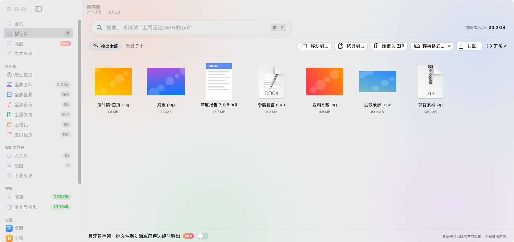</p>


## 像浏览相册一样浏览文件

网格 / 列表随时切换，缩略图大小可调，按种类、日期、大小排序。空格键快速查看，⌘I 打开简介面板，右键菜单和拖出到其他应用都支持。

<p align="center">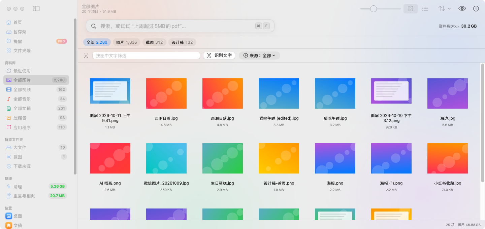</p>

- **识别图中文字**：用 Vision 在本机识别截图和照片里的中文、英文，一键拷贝，识别后还能按文字筛选。

## 一句话搜索

中文英文都行，拾掇会把这句话拆成可以单独去掉的筛选标签。

<p align="center">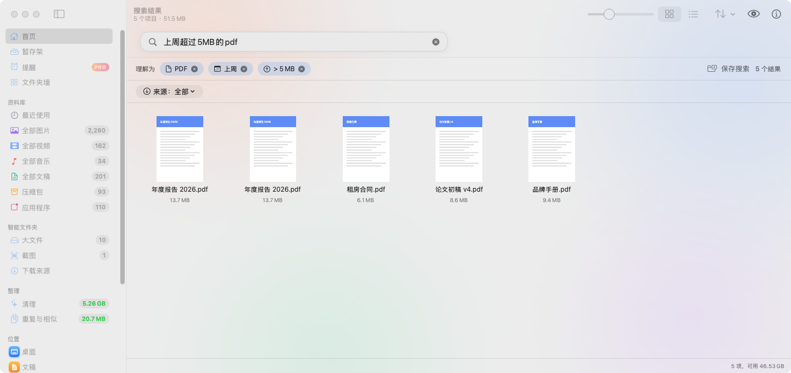</p>

试试这些：

- `上周超过5MB的pdf`
- `最近三天的照片`、`超过30天的截图`
- `从github下载的dmg`
- `来自微信的图片`、`qq邮箱收到的发票`、`pdfs from gmail`
- `large videos from youtube.com this month`

## 记得每个文件从哪来

自动认出 Gmail、QQ 邮箱、网易邮箱、微信、飞书、钉钉、小红书、百度网盘、阿里云盘、ChatGPT、Figma、GitHub、浏览器扩展等 30 多个来源，其余按网站分组。

<p align="center">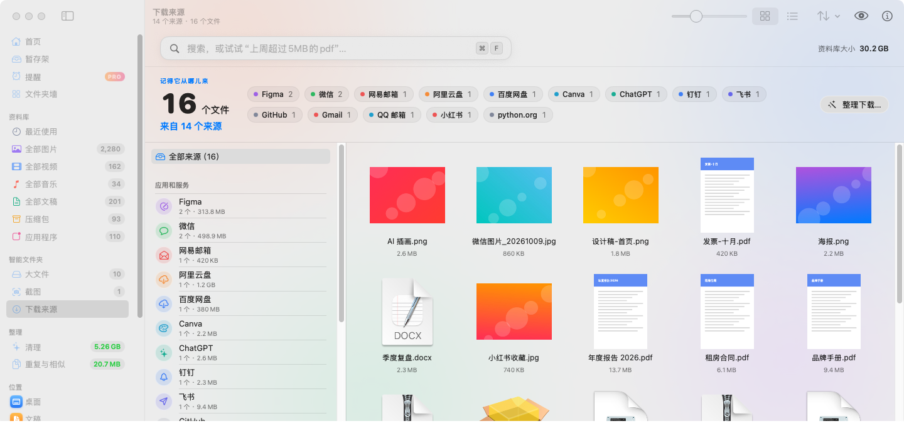</p>

## 放心清理

用过的安装包、被遗忘的下载、旧截图、很久没看的大视频、不常用的应用，分成卡片告诉你各能腾出多少空间。

<p align="center">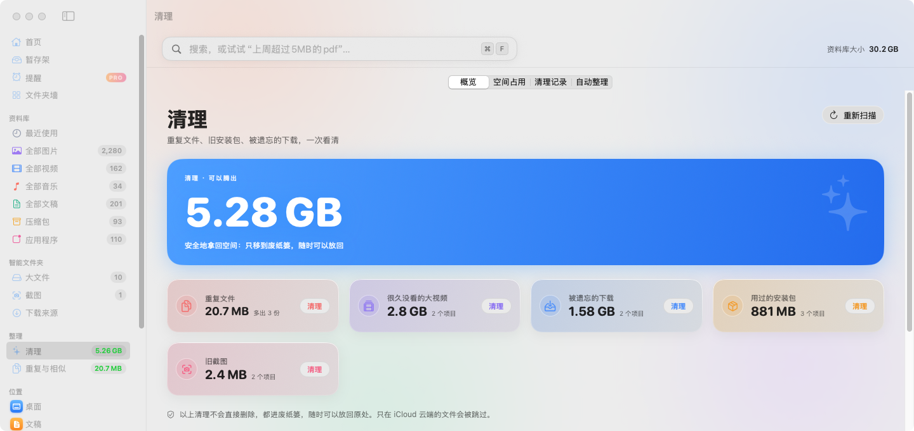</p>

- 一律只**移到废纸篓**，随时可以恢复；只在 iCloud 云端的文件一律跳过。
- **重复文件**：按大小和 SHA-256 指纹比对，只有内容完全相同才算重复。
- **相似照片**：用 Vision 图像特征找出连拍、重复截图等看起来差不多的照片。


## 更多好用的小工具

<p align="center">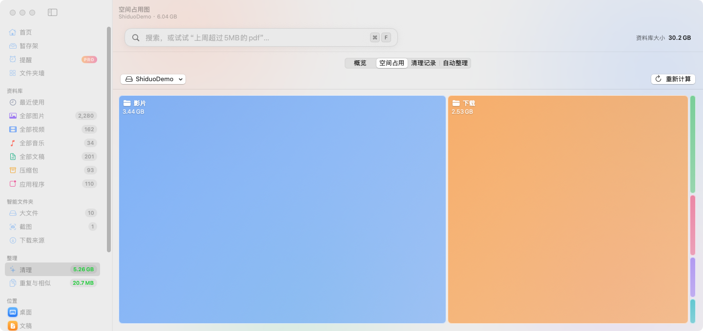</p>

- **空间占用图**：方块越大占得越多，点进去一层层往下看，哪个文件夹最大一眼就知道。
- **批量重命名**：按序号、修改日期或照片拍摄时间批量改名，还能替换文字、加前后缀，先预览再改。
- **转 JPG / 压缩**：HEIC、PNG 一键转成 JPG，可选尺寸和画质，发微信不再糊。
- **访达标签**：侧边栏按颜色标签浏览，右键直接打标签。
- **微信 / QQ 文件专区**：聊天里收到的文件集中在一处，清理页还会列出聊天大文件。
- **全局快速搜索**：在任何应用里按 ⌥空格 弹出搜索浮窗，拼音首字母也能搜（nb → 年报）。
- **图片直接选字**：预览图片时直接划选文字，电话、网址可以点。

## 拾掇 Pro

上面介绍的所有功能都**永久免费**，以后也不会挪进 Pro。拾掇 Pro 是给想再省点心的人准备的几样额外帮手，所有处理仍然只在你的 Mac 上完成。

| | 免费版 | 拾掇 Pro |
|---|:---:|:---:|
| 分类浏览、一句话搜索、下载来源、图中文字搜索 | ✅ | ✅ |
| 清理、重复文件、相似照片、空间占用图、批量重命名、图片转换 | ✅ | ✅ |
| 全局快速搜索浮窗、访达标签、暂存架 | ✅ | ✅ |
| **文件夹墙**：常用的文件夹放上一面卡片墙，两种图标样式（右下角小菜单或「设置 › 通用 › 文件夹墙」切换）：「拾掇风格」（默认）是半透明的 Liquid Glass 文件夹，照片、文稿透出真实预览，设计、云盘、归档文件夹探出里面文件的图标；「系统图标」显示访达里的图标，包括自定义图标和「文件夹上色」的结果。悬停直接重命名、移动，把文件拖到卡片上就移进去 | ✅ | ✅ |
| **外观**：跟随系统 / 浅色 / 深色（「设置 › 通用」） | ✅ | ✅ |
| **整理下载**：免费版可以打开面板、预览每个文件会按类型移到哪里，也能「只分组显示」；点「开始整理」真正移动文件是 Pro（一次「撤销全部」放回原处） | 预览 | ✅ |
| **自动整理规则**：按类型、扩展名、文件名、下载来源、放了多少天，把文件自动移到指定文件夹或废纸篓（拾掇开着时每 10 分钟一次，不覆盖同名文件，可撤销） | | ✅ |
| **定时清理提醒**：每周选一天一个时间提醒你「本周可腾出 X GB」，点通知直接打开清理页 | | ✅ |
| **按画面内容搜索照片**：搜「猫」「海边的照片」「收据」，用 Vision 在本机识别最近 2000 张照片的画面 | | ✅ |
| **外接磁盘**：侧边栏里直接浏览移动硬盘、U 盘，右键推出 | | ✅ |
| **菜单栏小助手**：启动磁盘剩余空间、最近 5 个下载、快速搜索、打开清理 | | ✅ |
| **悬浮暂存架**：拖着文件到刘海或屏幕左右边缘、或点一下刘海时弹出（也可以在设置里打开「鼠标移到刘海处就展开」），先放上去，切到别的 App 再拖出来；可选 自动 / 刘海 / 屏幕边缘，按显示器设置（也可以用快捷键打开，默认 ⌃⌥S，可在设置里换） | | ✅ |
| **文件提醒**：右键「提醒我处理…」，1 小时后、今晚、明早、下周一或自定义时间提醒，也可以在下次打开微信、钉钉、飞书、邮件时提醒；通知上直接打开、放上暂存架、推迟或完成 | | ✅ |
| **数字键直达**：⌃⌘1…9、0 把暂存架或最近下载里的第 1…10 个文件拷贝到剪贴板，按 ⌘V 粘贴；加 ⇧ 拷贝路径（不需要辅助功能权限） | | ✅ |
| **大文件搬家**：大文件一键搬到移动硬盘、NAS 或网盘，原处留替身，双击照样打开；30 天内可在「清理记录」里搬回来 | | ✅ |
| **保存搜索**：把「上周超过 5MB 的 PDF」这样的搜索存到侧边栏，相对日期每次重算，数量自动更新 | | ✅ |
| **文件夹上色**：给文件夹换颜色，加符号、表情或图片 | | ✅ |
| **拖进来就转换**：暂存架或右键「更多工具」里压缩视频、做 GIF、剪片段、把多个 PDF / 图片合并成一个 PDF；新文件放在原文件旁边，原文件不动，全部本机完成 | | ✅ |
| **卸载 App 连残留一起清**：列出 App 留在 `~/Library` 的应用数据、缓存、偏好设置、沙盒容器等，勾选后和 App 一起移到废纸篓，30 天内可在「清理记录」里恢复；不碰系统 App | | ✅ |
| **拼图**：多张截图横拼、竖拼，自动去掉重叠和重复的顶栏底栏；宫格、瀑布流、等高行；文字或图片水印、序号；原分辨率导出或限制长边 | | ✅ |
| **抠图和截图美化**：本机一键去背景（macOS 14 的 Vision），存成透明 PNG；截图加渐变背景、留白、圆角和阴影 | | ✅ |
| **标注、打码和 AI 放大**：截图上加箭头、方框、文字，本机自动给敏感文字打码；照片和插画 2× / 4× AI 放大，全部本机完成 | | ✅ |

<p align="center">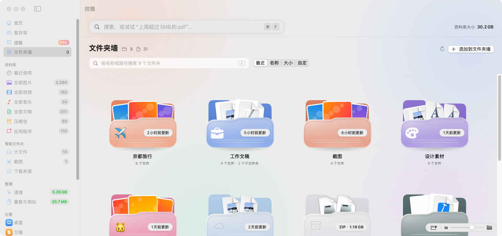</p>

<p align="center">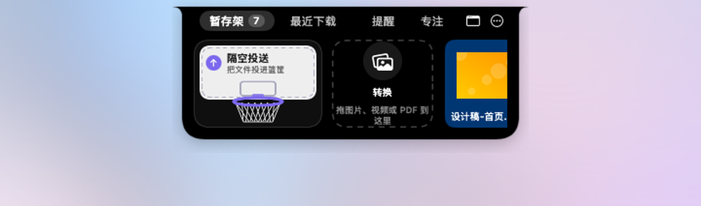</p>

<p align="center">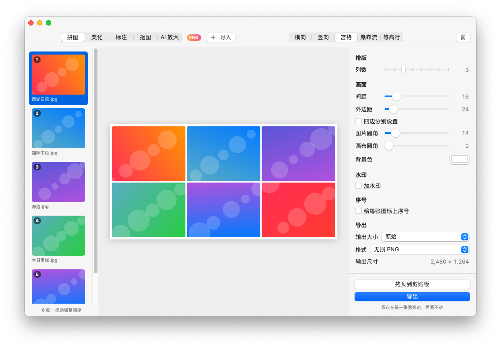</p>

<p align="center">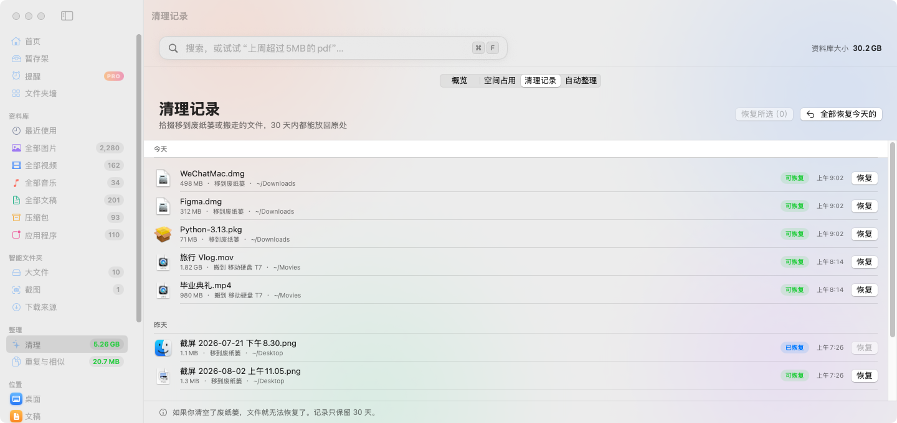</p>

- **价格：$9.90 美元，一次买断**，不是订阅，以后的 Pro 更新免费。付款由 Creem 处理。
- **7 天免费试用**：在付费页或「设置 › Pro」里点「开始 7 天免费试用」才开始计时（打开 Pro 页面不会自动开始），不用注册，也不填付款信息。
- 购买后在「设置 › Pro」里输入授权码激活；换 Mac 前可以先「解绑此 Mac」。
- 授权信息保存在本机（~/Library/Application Support/Shiduo/license.json，带本机签名，手改无效），不再用钥匙串，更新后不会再弹窗要钥匙串密码。每 24 小时最多联网校验一次，没网时也能继续用 30 天。

## 安装

1. 直接下载最新版 [Shiduo.dmg](https://github.com/hanson-zz/Shiduo/releases/latest/download/Shiduo.dmg)（历史版本在 [Releases](https://github.com/hanson-zz/Shiduo/releases)）
2. 打开 DMG，把“拾掇”拖进“应用程序”
3. 第一次打开时系统会拦一下（拾掇没有经过 Apple 公证），按下面的“首次打开”做一次就好

系统要求：macOS 14 Sonoma 或更新版本，Apple 芯片和 Intel 芯片均可。

### 首次打开

<p align="center">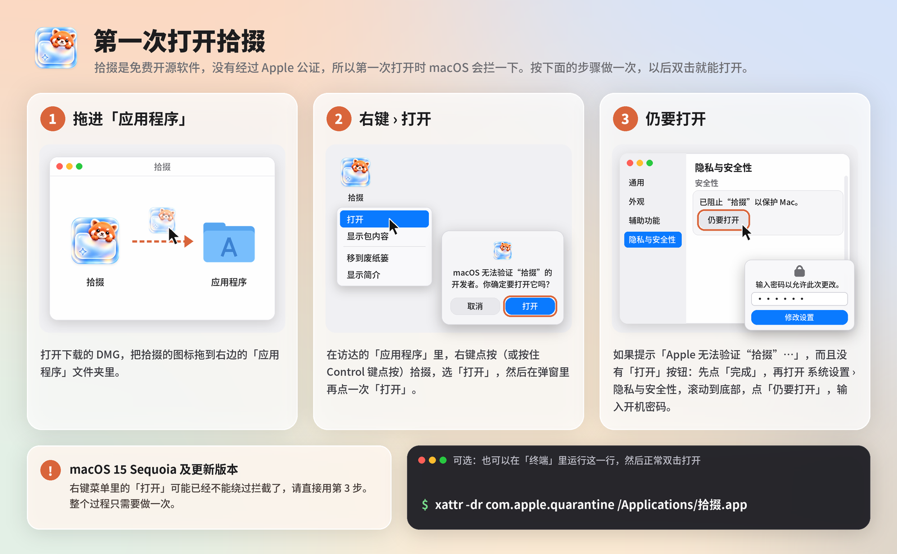</p>

1. 把 DMG 里的“拾掇”拖进「应用程序」。
2. 在访达的「应用程序」里**右键点按**（或按住 Control 点按）“拾掇”，选「打开」，再在弹窗里点「打开」。
3. 如果提示「Apple 无法验证“拾掇”…」而且没有「打开」按钮：先点「完成」，再打开 **系统设置 ▸ 隐私与安全性**，滚动到底部，点 **「仍要打开」**，输入开机密码。

可选：也可以在“终端”里运行这一行，然后正常双击打开：

```bash
xattr -dr com.apple.quarantine /Applications/拾掇.app
```

> macOS 15 Sequoia 及更新版本里，右键菜单的「打开」可能已经不能绕过拦截，请直接用第 3 步。整个过程只需要做一次。DMG 里也附了一张“首次打开请看我.png”。

## 权限说明

拾掇第一次读取“桌面”“文稿”“下载”里的文件时，系统会询问是否允许，请点“允许”。拾掇的分类和搜索依赖 Spotlight，如果你在系统设置里关闭了 Spotlight 索引，列表会是空的。

## 联网

拾掇只在两处联网：

- **检查更新**（设置里可开关），只会向 GitHub 读取最新版本号；
- **激活 / 校验拾掇 Pro 授权**，只把授权码和这台 Mac 的名称发给拾掇的授权服务器（转交 Creem 校验），每 24 小时最多一次。不用 Pro 就不会联网。

你的文件、文件名、搜索内容从不上传。

## 常见问题

**会上传我的文件吗？** 不会。文字识别、搜索、找重复全部在本机完成。拾掇只在检查更新和激活 Pro 授权时联网。

**会删掉我的文件吗？** 只会在你确认后移到废纸篓，随时可以放回原处，从不直接删除。iCloud 里只在云端的文件会被跳过，不会触发下载。个人文件夹、桌面、文稿、下载、资源库、应用程序这些 macOS 需要的文件夹，拾掇不会移动、改名或移到废纸篓。

**为什么要“完全磁盘访问权限”？** 微信 / QQ 文件在资源库里，空间占用图也要读取所有文件夹的大小。不开也能用其他功能。

**打开时提示“无法验证开发者”？** 拾掇是免费开源软件，没有付费购买 Apple 公证。请看上面的[首次打开](#首次打开)。

**能离线用吗？** 可以，完全离线可用。Pro 授权离线时也能继续用 30 天。

**收费吗？** 现有功能永久免费，MIT 开源。想要自动整理、清理提醒、按画面搜照片等额外功能可以试用 7 天后购买拾掇 Pro（见上面「拾掇 Pro」）。觉得好用可以点个 Star。

## 自己构建

需要 Xcode 16 和 [XcodeGen](https://github.com/yonaskolb/XcodeGen)：

```bash
brew install xcodegen
xcodegen generate
open Shiduo.xcodeproj
```

工程使用 ad-hoc 签名，不需要 Apple 开发者账号。推送 `v*` 标签后，GitHub Actions 会自动构建通用二进制并把 DMG 发布到 Releases。

README 里的截图由“截图”工作流生成：在 Actions 里手动运行它，会用演示数据启动拾掇（`Shiduo --demo --page=home|images|search|downloads|cleanup|duplicates|shelf [--dark]`），截下各个页面并提交到 `docs/screenshots`。

## 支持拾掇

拾掇完全免费、开源。如果它帮你省了时间、腾出了空间，可以：

- ⭐ 在 GitHub 上点个星
- 📤 分享给朋友
- ☕ 请作者喝杯咖啡（微信 / 支付宝扫一扫，金额随意）

<p>
  
  &nbsp;&nbsp;
  
</p>

问题和建议请发邮件到 694561981@qq.com，或在 [Issues](https://github.com/hanson-zz/Shiduo/issues) 里留言。

## 隐私与条款

- 官网：https://shiduo.app/
- [隐私政策 Privacy Policy](https://shiduo.app/privacy.html) · [服务条款 Terms of Service](https://shiduo.app/terms.html) · [退款政策 Refund Policy](https://shiduo.app/refund.html)
- 客服邮箱：694561981@qq.com

## 许可

[MIT](LICENSE)
